# Максим Петрунов — проекты

Три продукта — два собрал сам от идеи до запуска, в третьем играл ключевую роль в команде. По каждому: что это, для кого и зачем; почему именно такое решение; что сделано своими руками; какие AI-инструменты; что вышло.

Контакты: Telegram [@MFourKS](https://t.me/MFourKS) · mfourks@mail.ru · [github.com/MFourKS](https://github.com/MFourKS)

---

## 1. Hair Care Studio — подбор окрашивания и диагностика волос по фото

**Что это, для кого и зачем.** Сервис для бренда Splat: пользователь загружает фото, получает диагностику волос — тон корней и длины, процент седины, тип окрашивания, пористость — и готовую формулу окрашивания с виртуальной примеркой цвета. Второй модуль — диагностика состояния волос по нескольким ракурсам и подбор ухода. Пользователи двух типов: клиенты бренда, которые подбирают цвет сами, и мастера-колористы, которым нужна готовая формула — оттенок, пропорция, процент оксида, время выдержки.

**Почему именно такой продукт.** Подбор цвета в салоне держится на опыте конкретного мастера, результат плохо воспроизводится, а клиент до последнего не видит, что получится. Главное решение здесь было продуктовым, а не техническим: я развёл два сценария с разной ценой входа — быстрая примерка цвета без анкеты для тех, кто хочет просто посмотреть, и полный путь с диагностикой и анкетой для осознанного подбора. Заставлять всех проходить анкету значило бы потерять большинство на первом шаге.

**Что реализовал самостоятельно.** Всё: архитектуру, бэкенд на FastAPI из 25 REST-эндпоинтов, клиентский интерфейс, подключение vision-моделей через единый шлюз (модель диагностики и модель генерации меняются конфигурацией), автоматическую отбраковку негодных снимков, расчёт формулы, упаковку в Docker. Отдельно — детерминированный вывод модели с приведением к строгой схеме, чтобы фронтенд получал предсказуемый JSON.

**AI / Vibe Coding-инструменты.** Claude Code (Sonnet и Opus, позже Fable на поддержке) — вся разработка. Vision-модели Gemini через OpenRouter — диагностика и генерация примерки.

**Запуск и результат.** MVP за полтора месяца, продукт работает в продакшне, дальнейшее развитие ведёт команда компании по заказу бренда.

| Главная | Два сценария окрашивания |
|---|---|
| 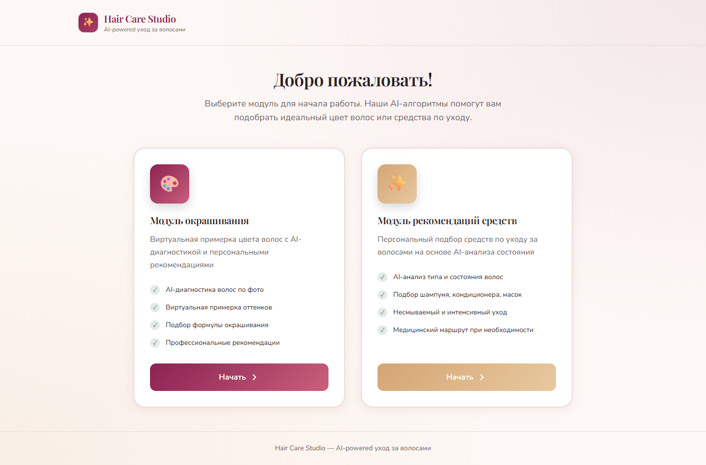 | 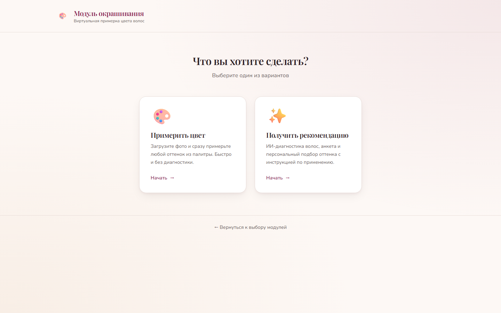 |

| Шаг диагностики | Модуль ухода |
|---|---|
| 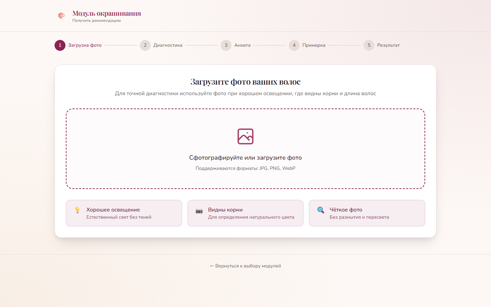 | 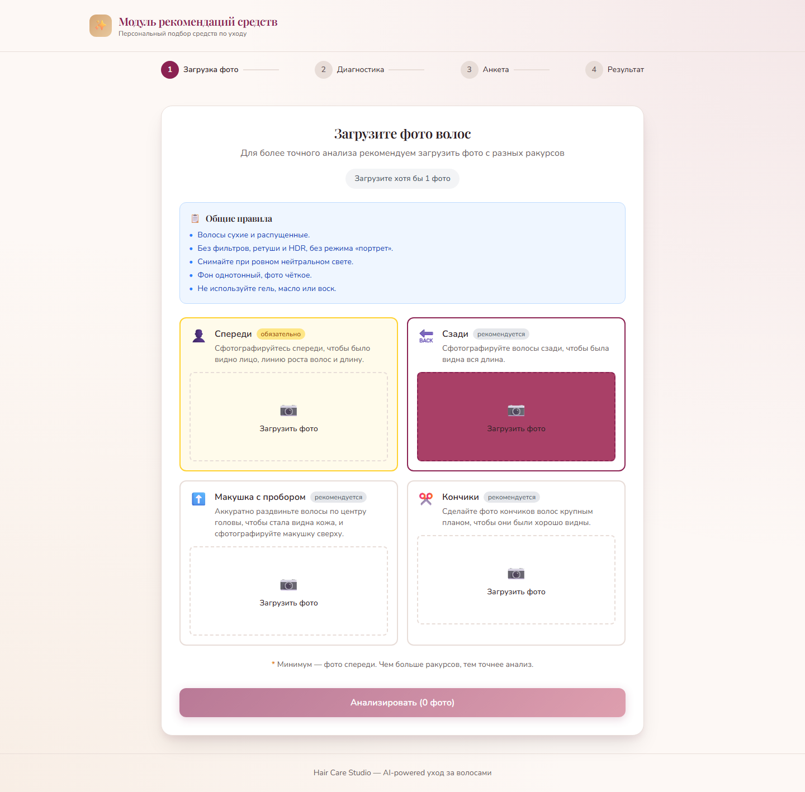 |

---

## 2. Realtor Radar — рынок вокруг твоих объектов

**Что это, для кого и зачем.** Инструмент для риелтора. Собирает объекты с площадок (ЦИАН, Домклик) и сайтов застройщиков по заданным критериям, следит за конкурентами каждого твоего объекта, ловит новые объявления по сохранённым фильтрам, разбирает, почему объект не продаётся, и готовит сообщение собственнику с аргументами по цене.

**Почему именно такой продукт.** Риелтор держит в голове десятки объектов и вручную мониторит площадки, чтобы понять, почему конкретная квартира стоит без звонков. Ответ почти всегда есть в данных — позиция по цене за метр относительно конкурентов, количество фото, длина описания, сколько новых объектов появилось за месяц, — но собирать их руками никто не будет. Продукт делает это сам и переводит в конкретные рекомендации: «дороже 70% рынка», «мало фотографий, у конкурентов в среднем 8», «расчётная цена быстрой продажи — 5,69 млн».

**Что реализовал самостоятельно.** Бэкенд на FastAPI и SQLAlchemy (async) поверх PostgreSQL 16, фоновые задачи на APScheduler, фронтенд на React 18 и TypeScript, сборщики на Playwright с честным поведением при защите от роботов — при ограничении сервис останавливается с понятной ошибкой, а не маскируется. Оценка объекта, расчётная цена, рекомендации, 36 проверок бизнес-логики в pytest, всё в Docker.

**AI / Vibe Coding-инструменты.** Claude Code — вся разработка, включая разбор того, как площадки отдают выдачу и что реально можно собирать.

**Запуск и результат.** Работает и доступен по ссылке выше. В базе около 3 900 реальных объектов по Ульяновску с ЦИАН и Домклика, по ним считается медиана рынка, позиция объекта и рекомендации; фоновые задачи сами пересматривают конкурентов и снимают ушедшие с рынка объекты.

| Дашборд | Анализ продажи объекта |
|---|---|
| 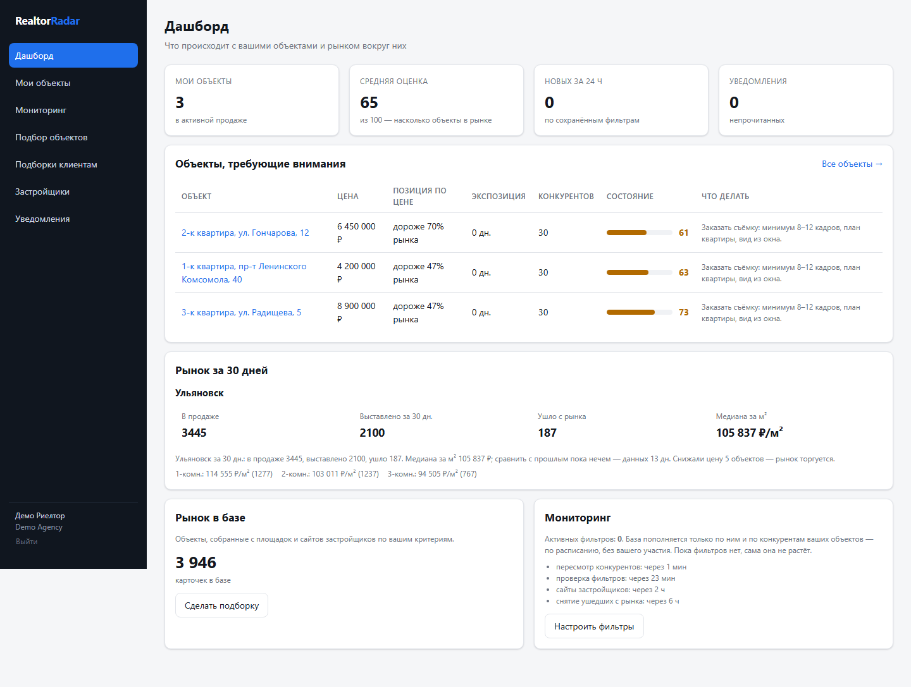 | 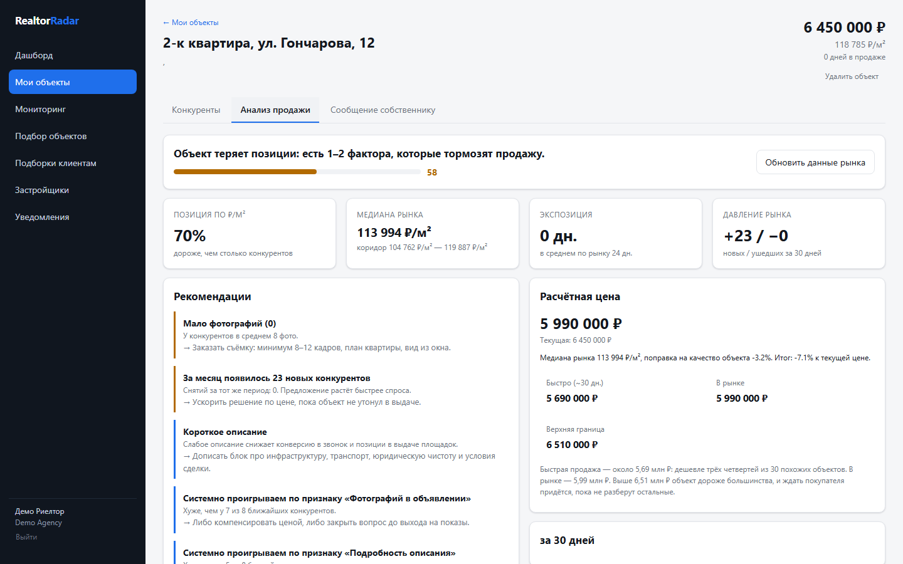 |

| Конкуренты на карте | Мои объекты |
|---|---|
| 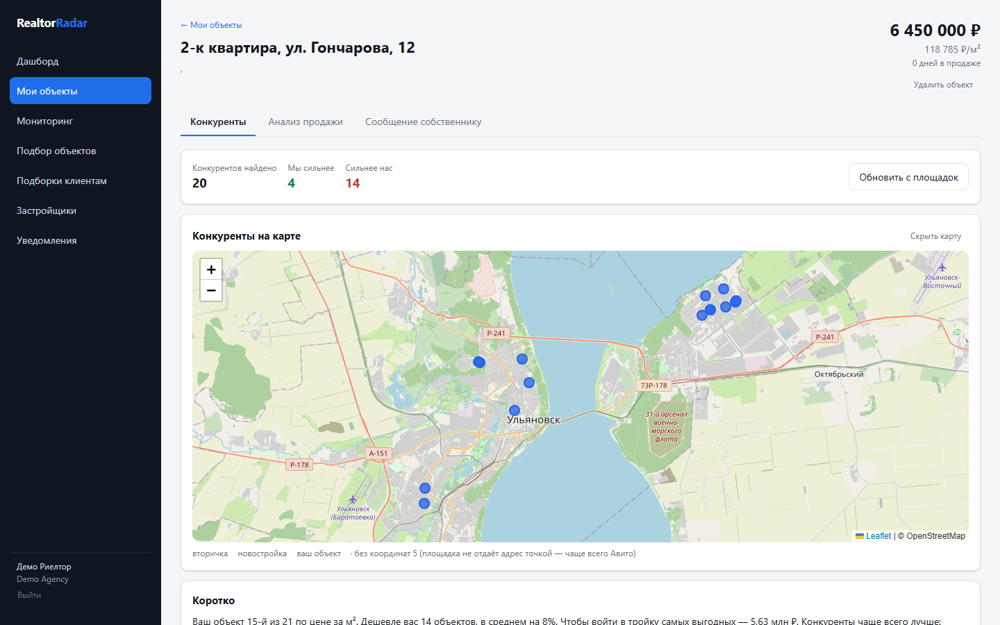 | 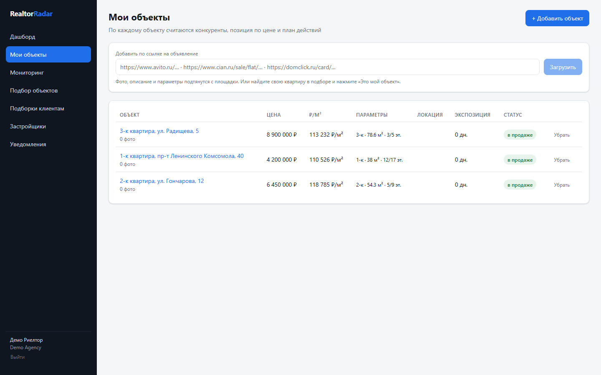 |

| Подбор объектов | Мониторинг |
|---|---|
| 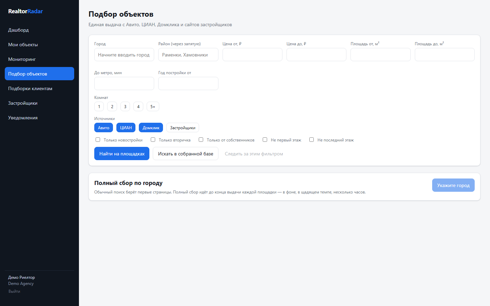 | 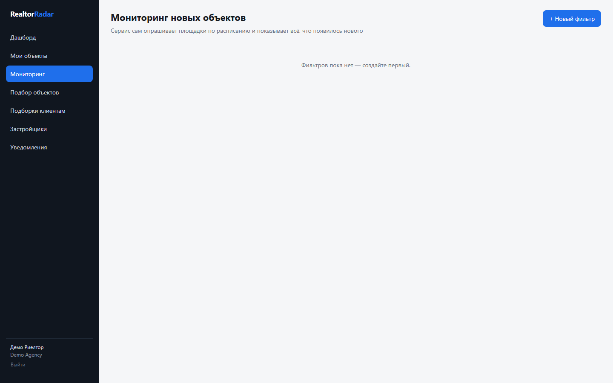 |

---

## 3. BeautyScan — анализ кожи и подбор косметики в магазинах «Магнит Косметик»

**Что это, для кого и зачем.** Покупатель в магазине фотографирует лицо, отвечает на несколько вопросов о коже — и получает диагностику и персональный набор ухода из того, что есть на полке именно этого магазина, в нескольких ценовых сегментах. Рядом — AR-примерка декоративной косметики и подбор парфюма. Для покупателя это консультант, которого в зале часто нет; для ритейлера — продажи тестового ассортимента и трафик.

**Почему именно такой продукт.** Продукт существовал с 2022 года как пилот. Перед масштабированием с 200 магазинов на 2 500 стало ясно, что модель, обученная на первых пилотах, не соответствует реальному распределению покупателей, а пользовательский путь перегружен. Доработка шла по двум линиям: данные и модель — и упрощение пути по обратной связи реальных покупателей. Именно в этой фазе я и работал.

**Что реализовал — моя роль в команде.** Проект командный, моя зона:
- модель распознавания состояния кожи: обучающие выборки, аугментации под условия съёмки на панели, дообучение, оптимизация инференса под отклик киоска;
- конвейер разметки с LLM-предразметкой, который и дал рост обучающей выборки — датасет доведён до 103 000 фотографий;
- бэкенд на Django/DRF с асинхронной обработкой через Celery и Redis, обслуживающий и веб, и панели — не менее 10 000 фотографий в сутки;
- интеграции с системами ритейлера: остатки и цены по FTP и API, встраивание сервиса через фрейм;
- развёртывание и эксплуатация модулей панели, включая AR-примерку.

**AI / Vibe Coding-инструменты.** PyTorch, OpenCV, MLflow — модель; LLM-предразметка — датасет; Claude Code — разработка на поздних этапах.

**Запуск и результат.** Работает в магазинах «Магнит Косметик»: тест по QR с 2022 года, 200+ точек в 2023, доработка перед масштабированием на 2 500 магазинов, панели в торговых залах. Публичные результаты Магнита: средний чек пользователей BeautyScan вырос на 29,2%, частота посещений магазинов — на 35% относительно контрольной группы. После двух лет разработки Магнит выкупил продукт и поддерживает его своими ресурсами.

Та же технология развёрнута и для сети «Глобус» — два экрана оттуда: старт и выбор функции (анализ кожи / примерка макияжа). Дальше сервису нужна камера, поэтому сценарий со снимком показываю на созвоне.

| Стартовый экран панели «Магнит Косметик» | Старт, «Глобус» |
|---|---|
| 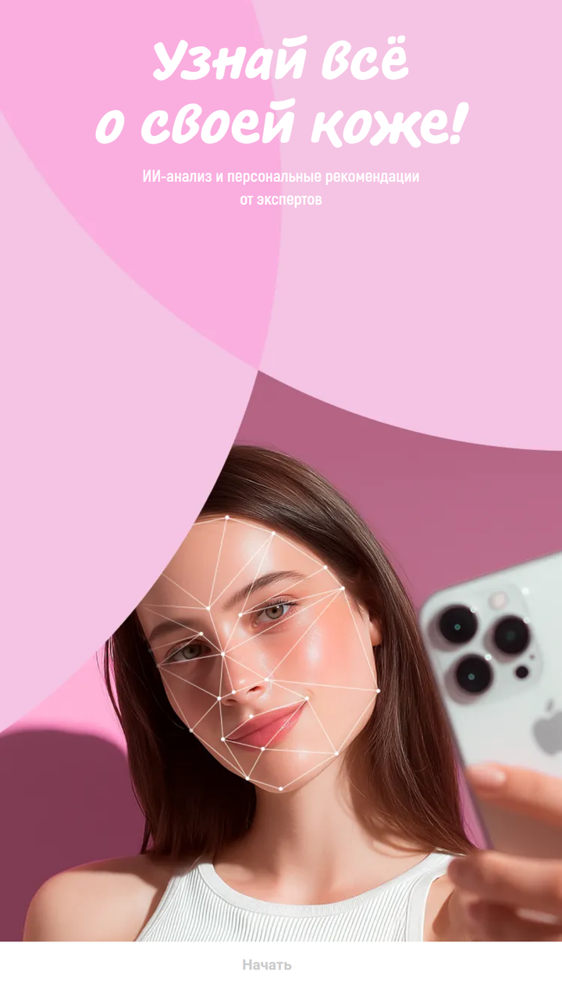 | 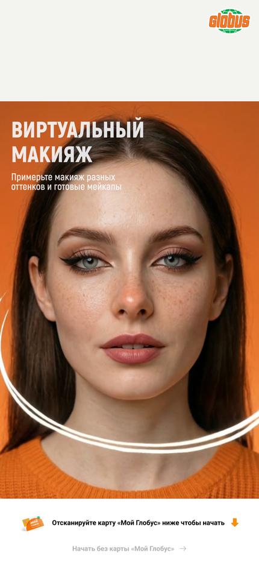 |

| Выбор функции, «Глобус» | Страница Магнита: что сделано и результаты |
|---|---|
| 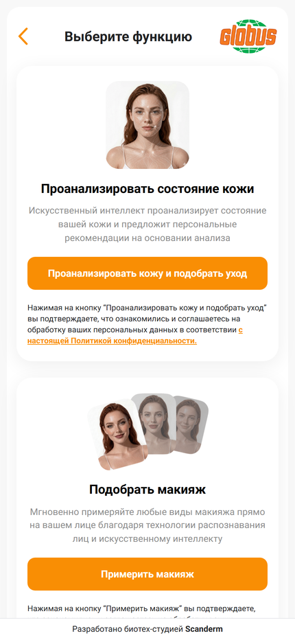 | 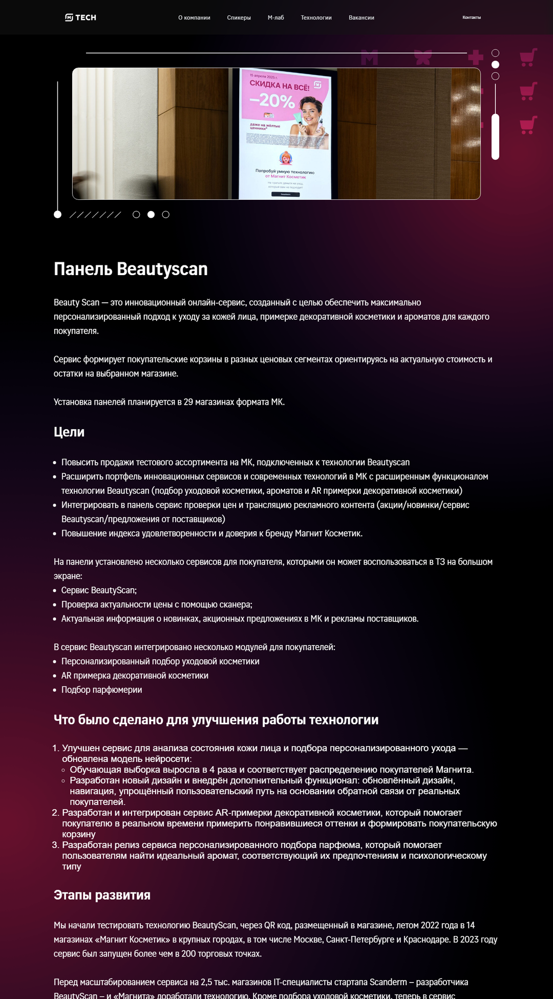 |

---

## Дополнительно

**cryptoweb** — личный стенд бумажной торговли на данных Hyperliquid: девять стратегий параллельно, раз в неделю сам ранжирует их по доходности и отключает слабые. Собран с Claude Code, работал на VPS с июня по сентябрь 2026. Результат — похоронил мои торговые гипотезы раньше, чем я вложил бы в них деньги; для этого и делался. 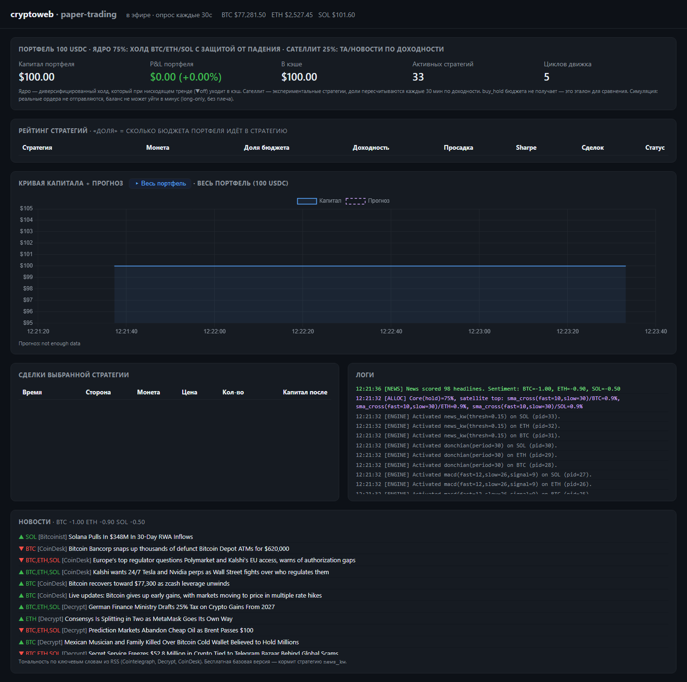

**[llm-quant-bench](https://github.com/MFourKS/llm-quant-bench)** — бенчмарк квантизаций локальных LLM на своей RTX 5060 Ti: Qwen2.5-7B в четырёх квантизациях против 14B, скорость, VRAM, perplexity, KL-дивергенция, задачи с JSON по схеме. Сделан за день, все скрипты, данные и графики в репозитории.

**Что ещё умею.** Обучаю CV-модели на PyTorch (распознавание дефектов кожи, болезней растений — 19 классов через каскад из трёх моделей), поэтому понимаю, что генеративная модель сделает, а что нет. Держу продовую инфраструктуру: ~15 сервисов на пяти серверах — Docker, nginx, TLS, CI/CD. Собрал конвейер разметки с LLM-предразметкой, доведённый до 103 000 фотографий.
